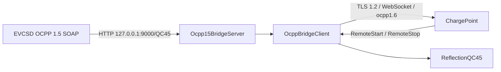

# OCPP Bridge

Die produktive Integration lässt das alte EVCSD weiterhin **OCPP 1.5 SOAP** sprechen, setzt davor aber einen lokalen Übersetzer auf **OCPP 1.6 JSON über WSS** zum ChargePoint-Backend.

## Datenpfad



## Standard-Loopback

```text
Bind: 127.0.0.1
Port: 9000
Path: /QC45
```

Damit bleibt die Legacy-Schnittstelle ausschließlich lokal erreichbar.

## SOAP → JSON weitergeleitete Operationen

Der aktuelle Bridge-Server behandelt unter anderem:

- BootNotification
- Heartbeat
- Authorize
- StatusNotification
- StartTransaction
- MeterValues
- StopTransaction
- FirmwareStatusNotification
- DiagnosticsStatusNotification
- DataTransfer

Transaktions-IDs werden dem jeweiligen Connector zugeordnet und atomar in
`ocpp.transactionMapFile` persistiert. Damit bleibt ein
Backend-`RemoteStopTransaction` auch nach einem Webapp-/JVM-Neustart auflösbar.
Fehlt ein gespeicherter Eintrag, versucht die Bridge die ID aus der laufenden
EVCSD-Transaktion zu lesen. Eine unbekannte ID wird abgelehnt: Auch genau eine
aktive Session beweist nicht, dass die angeforderte Transaktion zu ihr gehört.
Ein verspätetes RemoteStop darf keine inzwischen neu gestartete Ladung beenden.

Ein WebSocket-Timeout vor einem Frame ist normaler Leerlauf. Tritt der Timeout
nach dem ersten Frame-Byte auf, wird die Verbindung kontrolliert neu aufgebaut;
verbleibende Nutzdaten werden nicht als Header einer neuen Nachricht interpretiert.

Bei `MeterValues` verwendet die Bridge wieder das am 22. August bewährte
QC45-Verhalten: Aus einer Meldung wird ausschließlich die erste periodische
Energieprobe übernommen. Ihr vorhandener Measurand und ihre Einheit werden
unverändert weitergegeben. Nachfolgende Strom- oder Leistungsproben gelangen
nicht in die kWh-Verbrauchsreihe des Backends.

Insbesondere ergänzt die Bridge bei einem nackten Wert nicht mehr künstlich
`Power.Active.Import`, `kW` oder `Sample.Periodic`. `meterStart` und `meterStop`
bleiben davon vollständig unberührt.

## Statuskorrektur

Das alte EVCSD meldet Zustände nicht immer passend zur OCPP-1.6-Semantik. Die Bridge leitet deshalb Status aus Livezuständen ab:

- Leistung > 0 → `Charging`
- aktive Transaktion, Limit = 0 → `SuspendedEVSE`
- aktive Transaktion, keine Leistung, Limit > 0 → `SuspendedEV`
- nach bestätigtem Stop: native Freimeldung → `Available`; ohne Freimeldung
  bleibt konservativ `Finishing`

Die Bridge merkt sich den ursprünglichen nativen Status getrennt vom abgeleiteten
Status. EVCSD kann `Available` schon vor oder während `StopTransaction` melden.
Nach der Backendantwort wird diese Freimeldung erneut gesendet, damit ein zuvor
wegen der noch gemerkten Transaktion abgeleitetes `SuspendedEV` korrigiert wird.
Ein bereits freier Anschluss wird nicht wieder auf `Finishing` gesetzt.

Statusmeldungen werden pro Anschluss serialisiert. Eine während des Abschlusses
neu gestartete Transaktion oder ein gemeldeter Fehler wird von der verspäteten
Stop-Antwort nicht überschrieben. Beim nächsten Start wird die alte native
Statusbeobachtung verworfen; eine frühere Freimeldung gilt nicht für die neue
Sitzung. Fehlerdetails bleiben in der ursprünglichen Statusmeldung erhalten.

Ein eingehendes OCPP-1.5-`Occupied` wird in Richtung 1.6 zunächst als `Preparing` behandelt.

## Backend-Kommandos

`OcppBridgeClient` akzeptiert aktuell:

| OCPP 1.6 CALL | Verhalten |
|---|---|
| `RemoteStartTransaction` | an `ReflectionQC45.remoteStart()` |
| `RemoteStopTransaction` | anhand gemerkter Transaktion an richtigen Connector |
| `Reset` | `Rejected` |
| `UnlockConnector` | `NotSupported` |

## Transport

- ausschließlich `wss://`
- TLS 1.2
- Basic Authentication
- WebSocket Subprotocol `ocpp1.6`
- CA-Datei konfigurierbar
- optional `tls.insecure=true` für Diagnose, nicht für Normalbetrieb empfohlen
- Reconnect mit exponentiellem Backoff bis 30 s
- Unabhängiger 100-ms-Deadline-Wächter: Ein ausbleibendes OCPP-Ergebnis
  schließt den betroffenen Transport und löst Reconnect aus, auch bei einem
  blockierten Schreibzugriff. Das Zeitbudget umfasst Senden und Warten und
  verwendet eine monotone Uhr. Standard: `ocpp15.bridge.timeoutMs=10000`.
- Keine automatische Wiederholung eines fehlgeschlagenen CALLs, insbesondere
  kein blindes erneutes `StartTransaction`. EVCSD erhält weiterhin einen Fehler
  und behält die Verantwortung für seinen Transaktionsablauf.
- TCP-Verbindungsaufbau und TLS-/Upgrade-Lesezugriffe sind auf 10 s begrenzt.
- Prüfung der TLS-Hostname-Identität und des vom Backend bestätigten
  `ocpp1.6`-Subprotokolls
- Reassembly fragmentierter Textnachrichten bis maximal 1 MiB

Der lokale SOAP-Endpunkt darf ausschließlich an eine Loopback-Adresse binden,
begrenzt Requests auf 1 MiB und nutzt einen begrenzten Vier-Thread-Executor.
Beim Shutdown werden HTTP-Executor und WebSocket-Thread beendet.

## Kommunikationszustand

`/home/mobie/evcsd/qc45-integration-health.properties` ergänzt den lokalen
Prozess-/Deploymentstatus um folgende Felder:

| Feld | Bedeutung |
|---|---|
| `ocpp.state` | `disconnected`, `awaiting-response`, `ready`, `unresponsive`, `stopped` oder `disabled` |
| `ocpp.connected` | aktueller Transport offen; allein noch kein Beweis für erfolgreiche OCPP-Kommunikation |
| `ocpp.responseAgeMs` | monotones Alter der letzten zugeordneten CALLRESULT-/CALLERROR-Antwort; `-1` ohne Antwort auf dieser Verbindung |
| `ocpp.connections` | Anzahl erfolgreicher Verbindungsaufbauten seit JVM-Start |
| `ocpp.responseTimeouts` | Anzahl wegen überschrittener Antwortfrist abgebrochener Verbindungen |

`ready` erfordert eine Antwort auf der aktuellen Verbindung innerhalb der
letzten 120 s (bei regulären 60-s-Heartbeats). Ein erreichbarer Backendfehler
(`CALLERROR`) zählt als Kommunikationsnachweis und erzwingt keinen Reconnect.
Der allgemeine `state` bleibt der Zustand der lokalen Schutz-/Steuerthreads;
ein externer Netzausfall löst dadurch keinen JAR-Rollback oder Stationsreboot
aus. Der Deadline-Wächter gehört zu den überwachten lokalen Threads.

Quellcode:

- `https://github.com/BugUser0815/QC45/blob/native-integration/native-integration/src/main/java/de/rothner/qc45/Ocpp15BridgeServer.java`
- `https://github.com/BugUser0815/QC45/blob/native-integration/native-integration/src/main/java/de/rothner/qc45/OcppBridgeClient.java`

Siehe auch: [RemoteStart & Autorisierung](RemoteStart-und-Autorisierung).
