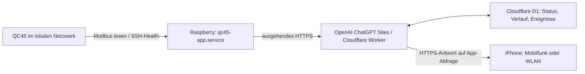

# iPhone-App und Cloud-Anbindung

**Stand: 9. November 2026.** Architektur und Konfiguration wurden anhand des
eingerichteten App-/Site-Quellcodes geprüft. Die Hosting- und Preisangaben wurden
am selben Tag mit der offiziellen OpenAI-Dokumentation abgeglichen.

## Zweck und Datenweg

Die native QC45-iPhone-App und die private Weboberfläche zeigen Stationswerte,
OCPP-Status, Leistungsfreigaben, Verlauf und Ereignisse. Der Fernzugriff läuft
über einen Cloud-Dienst. Das iPhone muss sich deshalb nicht im SGS-Netzwerk
befinden.

1. Der Python-Datensammler auf dem Raspberry liest Modbus-FC03-Register 126–145
   und die Health-Datei der Stationsintegration über SSH.
2. Der Raspberry überträgt die Daten an die private Site. Der Sollabstand beträgt
   ungefähr zehn Sekunden; Stationsabfrage, SSH und Übertragung können den
   tatsächlichen Abstand verlängern.
3. Die Site speichert den letzten Zustand, den Verlauf und Ereignisse in D1.
4. Die iPhone-App fragt den Dienst im Vordergrund ungefähr alle zehn Sekunden ab,
   jeweils zusätzlich zur Laufzeit der Anfrage.

Der Raspberry startet den Datensammler als Systemdienst beim Hochfahren und
startet ihn bei einem Prozessfehler erneut. Die iPhone-App steuert in diesem
Stand keine Stationshardware; Start/Stopp und Änderungen der Leistungsgrenzen
sind über diese Geräte-API nicht verfügbar. Die bestehende OCPP-, Lade- und
Schutzlogik bleibt für den Stationsbetrieb zuständig.

## Voraussetzungen für Zugriff von überall

- Das iPhone benötigt eine Internetverbindung, beispielsweise Mobilfunk oder
  ein beliebiges WLAN.
- Der Raspberry muss laufen, die Station lokal erreichen und die Site über
  ausgehendes HTTPS erreichen können.
- Die Cloud-Site muss verfügbar und der persönliche Gerätezugang gültig sein.

Für diesen Datenweg sind weder ein VPN auf dem iPhone noch eingehende
Portfreigaben am SGS-Router erforderlich. Die lokale Stationsadresse wird vom
iPhone nicht direkt angesprochen.

Fehlen neue Daten, behandelt die Anzeige diese als veraltet. Aktuelle
Stationstelemetrie hat eine Frischegrenze von 30 Sekunden; für die OCPP-Health
gilt wegen der zusätzlichen Publikations-, SSH- und Abfragezeiten ein Budget
von 40 Sekunden. Neue gemeldete Fehler werden unmittelbar übernommen.
Cloud-Erreichbarkeit und OCPP-Erreichbarkeit des bestehenden Ladebackends sind
verschiedene Zustände.

## Zugangsschutz

Die Weboberfläche bleibt auf den Eigentümer beschränkt. Die native App nutzt
einen persönlichen Gerätezugang für Status und Verlauf. Dieser wird im
iPhone-Schlüsselbund gespeichert, ist serverseitig widerrufbar und läuft nach
180 Tagen ab. Der Datensammler verwendet einen getrennten Zugang zum Einliefern
von Messwerten. Die Übertragung zwischen Raspberry, Site und App erfolgt über
HTTPS.

Geräte-Verbindungsdateien, Dienst- und Geräte-Token, private Konfigurationsdateien,
SSH-Schlüssel und Apple-Schlüssel gehören nicht in GitHub.

## Hosting und Standort

Der Cloud-Dienst wird über **OpenAI ChatGPT Sites** betrieben.
Die technische Basis des eingerichteten Projekts ist ein **Cloudflare Worker**
mit einer **Cloudflare-D1-Datenbank**. Es wurde dafür kein separates Server-Abo
bei einem anderen Hosting-Anbieter eingerichtet.

Der konkrete Rechenzentrumsstandort beziehungsweise das Land wird in den
abrufbaren Hosting-Projektdaten nicht ausgewiesen. Aus der Domain oder der
verwendeten Technik lässt sich daher keine Zusicherung für einen bestimmten
deutschen oder europäischen Speicherort ableiten.

## Laufende Kosten

**Preisstand: 9. November 2026; keine dauerhafte Preiszusage.**

- **Bis 31. Dezember 2026:** Hosting laut OpenAI kostenlos.
- **Ab 1. Januar 2027:** Verbrauchsmessung vorgesehen. Zusatzgebühren sollen nur
  oberhalb des monatlichen Hosting-Kontingents des ChatGPT-Plans entstehen.
  Enterprise-Abrechnung folgt der Organisationsvereinbarung.

Für Januar 2027 nennt OpenAI diese **vorgeschlagenen, ungefähren Raten vor
Anrechnung des Plan-Kontingents**:

| Relevanter Verbrauch | Credits |
| --- | --- |
| Site mit Datenbank, auch bei leerer Datenbank | 25 pro Monat |
| Anfragen | 16 je 100.000 |
| Datenbankinhalt | 150 je GiB und vollem Monat |

Die Raspberry-Uploads und Abfragen der geöffneten App erzeugen Anfragen; der
Verlauf belegt Datenbankspeicher. Die tatsächliche Zuzahlung hängt von Verbrauch,
Plan-Kontingent und endgültigen Konditionen ab. Das persönliche Restkontingent
ist in den abrufbaren Projektdaten nicht enthalten; eine feste Euro-Summe ist
damit nicht belegt. Laut Ankündigung soll die Nutzungsanzeige pro Site ab
1. Dezember 2026 verfügbar sein.

Für dieses Projekt wurde kein separates Server-Abo abgeschlossen. Reguläre
ChatGPT-Abogebühren sowie vorhandene Strom- und Internetkosten bleiben bestehen.
Der normale QC45-Datenbetrieb benötigt keine kostenpflichtigen KI-Modellaufrufe.

Quellen, geprüft am 9. November 2026:
[OpenAI: Sites – Pricing](https://learn.chatgpt.com/docs/sites#pricing) und
[OpenAI: Pricing – Sites](https://learn.chatgpt.com/docs/pricing#how-much-does-sites-cost).

## Push-Mitteilungen

Native Push-Mitteilungen sind derzeit deaktiviert. Der beschriebene Fernzugriff
funktioniert unabhängig davon; die App aktualisiert ihre Daten im Vordergrund.

## Weitere Dokumentation

- [Systemarchitektur](https://github.com/BugUser0815/QC45/blob/main/wiki/Systemarchitektur.md)
- [Modbus TCP](https://github.com/BugUser0815/QC45/blob/main/wiki/Modbus-TCP.md)
- [Konfiguration und Betrieb](https://github.com/BugUser0815/QC45/blob/main/wiki/Konfiguration-und-Betrieb.md)
